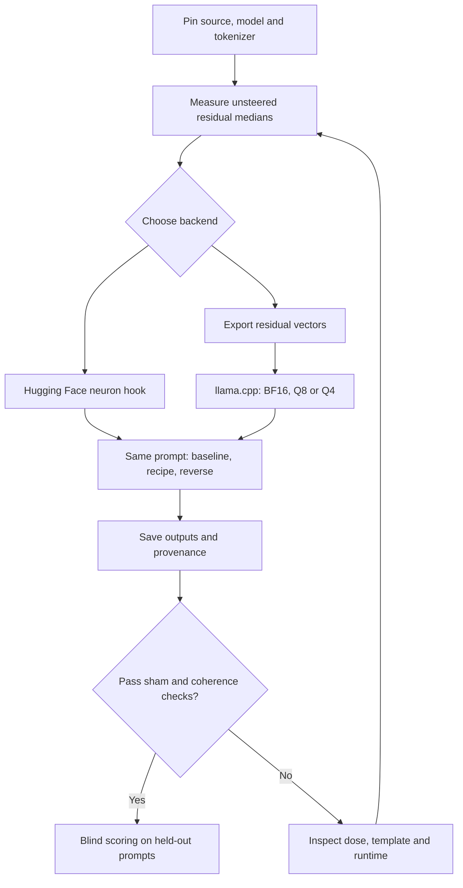
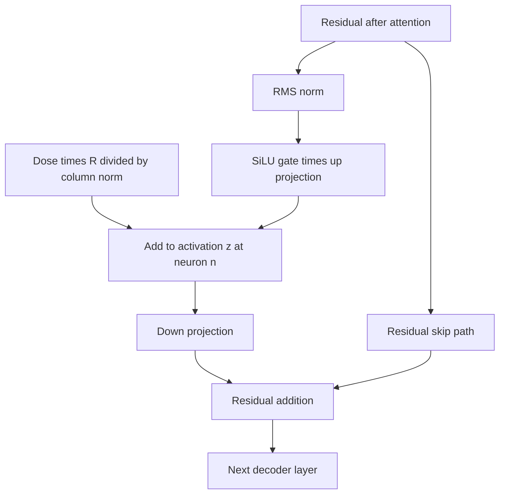
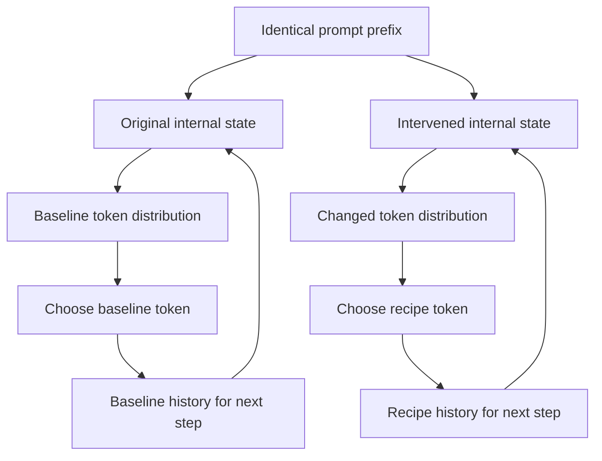

# Workflows and intervention diagrams

## Experiment workflow

## Exact location of the additive intervention

## Why autoregressive replies diverge

The loops after the first token no longer share identical histories. Use teacher-forced common prefixes when isolating local distribution changes. Arrow width and animation speed are explanatory; they do not encode measured signal magnitude or latency.
